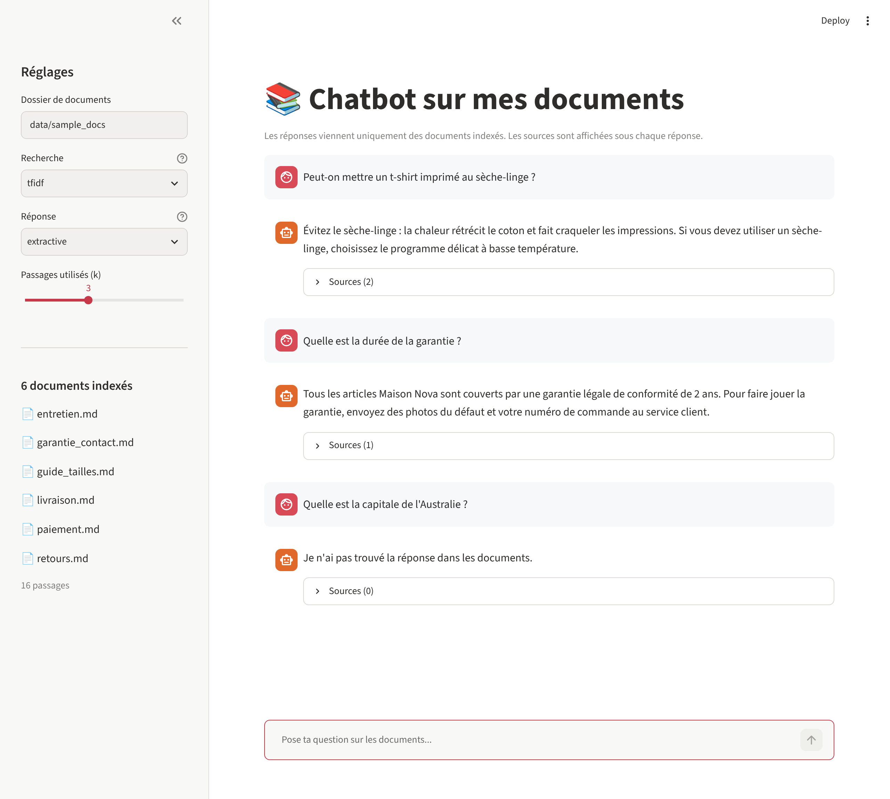
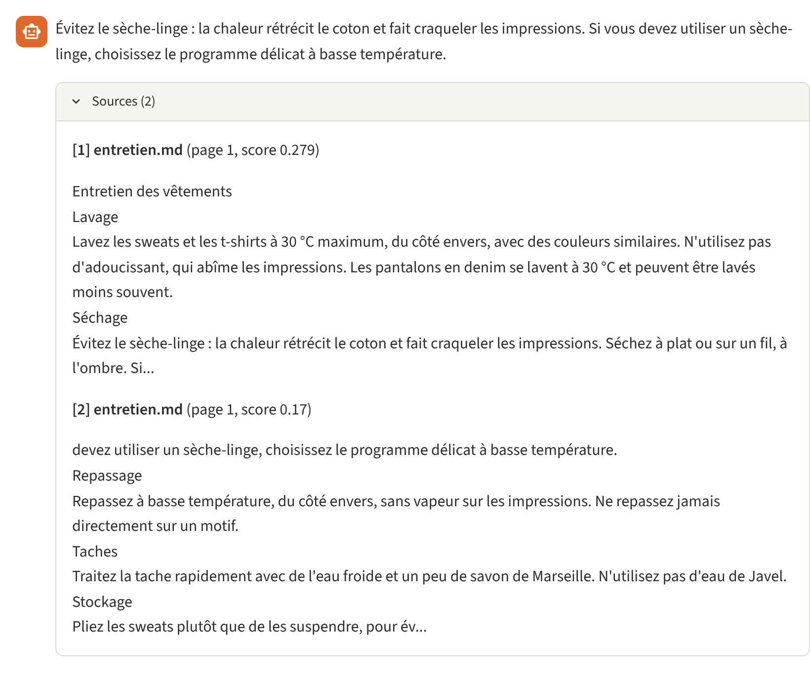

# 📚 Chatbot RAG sur mes documents

> Un chatbot qui répond aux questions **uniquement à partir de tes documents** (PDF, Markdown, texte) et **cite ses sources**. Il dit « je n'ai pas trouvé » quand l'information n'existe pas, au lieu d'inventer.

**Stack :** Python · scikit-learn · sentence-transformers (option) · Ollama / API Claude (option) · Streamlit · pypdf



## Sommaire

1. [Le problème](#le-problème)
2. [Comment ça marche (RAG)](#comment-ça-marche-rag)
3. [Installation et utilisation](#installation-et-utilisation)
4. [Évaluation de la recherche](#évaluation-de-la-recherche)
5. [Exemples](#exemples)
6. [Structure du projet](#structure-du-projet)
7. [Choix techniques](#choix-techniques)
8. [Limites et pistes d'amélioration](#limites-et-pistes-damélioration)

---

## Le problème

Un LLM seul n'a pas lu *tes* documents (règlement, FAQ d'un site, cours, contrats) et peut inventer une réponse plausible mais fausse. Le **RAG** (*Retrieval-Augmented Generation*) règle ça : on retrouve d'abord les passages utiles dans les documents, puis on répond à partir de ces passages seulement.

## Comment ça marche (RAG)

```
 Documents (.pdf .md .txt)
        │  découpage en passages (~600 caractères, avec chevauchement)
        ▼
   Index de recherche ◄──────────────┐
        │                            │
 Question ──► passages les plus pertinents (top-k)
                    │
                    ▼
            Génération de la réponse
          (extractive | Ollama | API Claude)
                    │
                    ▼
          Réponse + sources citées
```

| Étape | Fichier | Rôle |
|---|---|---|
| Chargement et découpage | `src/loader.py` | Lit les PDF/MD/TXT, coupe en passages de ~600 caractères |
| Recherche | `src/retriever.py` | **TF-IDF** (mots-clés) ou **embeddings** (sens) |
| Réponse | `src/generator.py` | **Extractive** (sans LLM), **Ollama** (LLM local) ou **API Claude** |
| Pipeline | `src/rag.py` | Relie les trois étapes |
| Évaluation | `src/evaluate.py` | Mesure la qualité de la recherche (Hit@k, MRR) |
| Interface | `app.py` | Chat Streamlit avec sources dépliables |

**Trois modes de réponse :**
- `extractive` : pas de LLM, renvoie les phrases les plus proches de la question. Gratuit, instantané, mais limité.
- `ollama` : LLM open source en local ([ollama.com](https://ollama.com)), gratuit, sans clé.
- `anthropic` : API Claude (variable `ANTHROPIC_API_KEY`), meilleure qualité.

## Installation et utilisation

```bash
git clone https://github.com/abdallah-76/rag-docs-chatbot.git
cd rag-docs-chatbot
python -m venv .venv && source .venv/bin/activate   # Windows : .venv\Scripts\activate
pip install -r requirements.txt
streamlit run app.py
```

Ça marche tout de suite, sans clé ni téléchargement de modèle, sur les 6 documents d'exemple de `data/sample_docs/` (FAQ d'une boutique **fictive**, « Maison Nova »).

**Utiliser tes propres documents :** mets tes PDF/MD/TXT dans un dossier (par ex. `data/private/`) et indique-le dans la barre latérale de l'app.

**Options :**
```bash
# Recherche par le sens (comprend les paraphrases)
pip install -r requirements-embeddings.txt          # puis choisir « embeddings » dans l'app

# LLM local
ollama pull llama3.2                                # puis choisir « ollama » dans l'app

# API Claude
export ANTHROPIC_API_KEY=...                        # Windows : $env:ANTHROPIC_API_KEY="..."
pip install anthropic                               # puis choisir « anthropic » dans l'app
```

## Évaluation de la recherche

Dans un RAG, si la recherche ne trouve pas le bon passage, la meilleure génération du monde ne sert à rien. J'ai donc mesuré la recherche séparément : 16 questions écrites à la main (`eval/questions.json`), chacune avec le document qui contient la réponse.

- **Hit@1** : le bon document est classé premier
- **Hit@3** : il est dans les 3 premiers
- **MRR** : moyenne de 1/rang du bon document (1.0 = toujours premier)

```bash
python src/evaluate.py                                  # TF-IDF
python src/evaluate.py --retrievers tfidf embeddings    # comparaison
```

Résultat mesuré avec **TF-IDF** :

| Retriever | Questions | Hit@1 | Hit@3 | MRR |
|---|---|---|---|---|
| tfidf | 16 | 94 % (15/16) | 100 % | 0.958 |

La seule erreur : « Quand serai-je remboursé après avoir renvoyé mon colis ? » classée sur `livraison.md` au lieu de `retours.md` : les mots « colis » et « renvoyé » ressemblent plus au texte de la livraison, alors que la réponse est dans la section « Remboursement » du document des retours.

> ⚠️ Le jeu de test est petit (16 questions) et le corpus ne fait que 6 documents courts : ces chiffres montrent que la méthode fonctionne, pas qu'elle tiendrait sur une grosse base documentaire. Les embeddings n'ont pas encore été évalués dans ce dépôt (voir la commande ci-dessus).

## Exemples

Réponse avec ses sources dépliées :



- Question dans les documents : « Peut-on mettre un t-shirt imprimé au sèche-linge ? » → « Évitez le sèche-linge : la chaleur rétrécit le coton et fait craqueler les impressions. [...] »
- Question hors sujet : « Quelle est la capitale de l'Australie ? » → « Je n'ai pas trouvé la réponse dans les documents. »

## Structure du projet

```
rag-docs-chatbot/
├── app.py                   # interface de chat Streamlit
├── requirements.txt
├── requirements-embeddings.txt
├── data/sample_docs/        # 6 documents d'exemple (boutique fictive)
├── eval/questions.json      # questions d'évaluation
├── results/                 # résultats de l'évaluation
├── docs/                    # captures d'écran
└── src/
    ├── loader.py            # chargement + découpage
    ├── retriever.py         # TF-IDF / embeddings
    ├── generator.py         # extractive / Ollama / Claude
    ├── rag.py               # pipeline
    ├── evaluate.py          # évaluation de la recherche
    └── textutils.py         # mots vides français
```

## Choix techniques

- **Fonctionne sans clé ni téléchargement** (TF-IDF + mode extractif) pour que n'importe qui puisse lancer le projet en 2 minutes ; les options plus puissantes se branchent ensuite.
- **Recherche et génération séparées**, pour pouvoir changer l'une sans toucher l'autre et évaluer chacune.
- **Sources toujours affichées** et refus de répondre quand rien ne correspond, pour limiter les réponses inventées.
- **Mots vides français** retirés (sinon « quelle est la » fait remonter n'importe quel passage).
- **Prompt LLM contraint** : répondre uniquement avec les extraits, citer [1], [2], sinon dire que l'information est absente.

## Limites et pistes d'amélioration

- **Le mode extractif est basique** : il choisit des phrases, il ne reformule pas et peut rater la bonne phrase. Exemple réel : à « Combien coûte la livraison en France pour 70 euros ? », il renvoie la ligne « express 9,90 € » au lieu de « gratuit dès 60 € ». Un vrai LLM (Ollama ou Claude) répond bien mieux ; c'est le rôle des deux autres modes.
- **TF-IDF compare des mots, pas le sens** : « horaires du service client » ne retrouve pas bien « joignable du lundi au vendredi de 9 h à 18 h ». Les embeddings sont faits pour ça.
- **Pas de mémoire de conversation** : chaque question est traitée seule.
- **Pistes :** évaluer aussi la qualité des réponses finales (pas seulement la recherche), recherche hybride (TF-IDF + embeddings), reranking, support de l'upload de fichiers dans l'app.

---

Projet réalisé par Abdallah Maammar, Master Intelligence Artificielle (Université Toulouse III).
